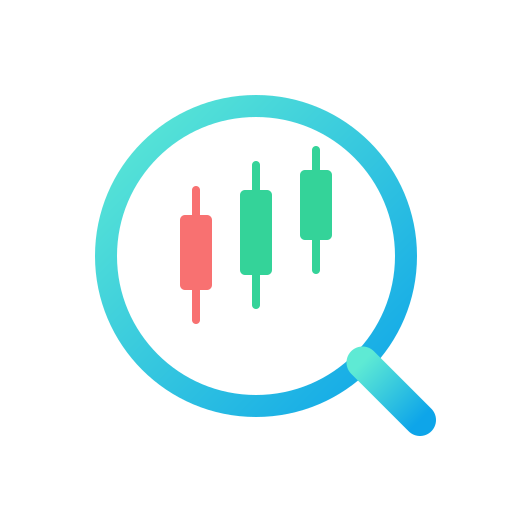

<p align="center"></p>

# Teropong

Terminal charting desktop untuk macOS (Apple Silicon): chart WebGL2, Pine Script v6, watchlist multi-bursa, alert, dan Trade Plan, semuanya berjalan lokal.

> **Based on trawangan (https://github.com/KaleksananBarqi/trawangan), Created by Kaleksanan Barqi Aji Massani**
>
> Teropong adalah karya turunan dari trawangan di bawah Apache License 2.0. Lihat berkas [`NOTICE`](NOTICE) untuk atribusi lengkap, termasuk LuxAlgo Vela dan PineTS. Dokumentasi fitur asli ada di [`README.trawangan.md`](README.trawangan.md), [`README.id.md`](README.id.md), dan [`README.en.md`](README.en.md).

## Instalasi (macOS)

1. Unduh berkas `.dmg` terbaru dari halaman [Releases](https://github.com/tedim20/teropong/releases/latest).
2. Buka `.dmg`, seret **Teropong** ke folder **Applications**.
3. Pembukaan pertama: klik kanan **Teropong** → **Open** → **Open**. Aplikasi ini tidak ditandatangani Apple Developer ID, jadi macOS meminta konfirmasi sekali.

Pembaruan berikutnya datang otomatis dari dalam aplikasi.

## Pengembangan

```bash
npm ci
npm run tauri dev     # jalankan versi pengembangan
npm test              # jalankan suite tes
```

Rilis dibuat otomatis oleh GitHub Actions setiap kali tag `v*` di-push (hanya macOS).

## Kredit, Atribusi Engine, Pustaka & Aset Open-Source

`trawangan` (dan karena itu juga Teropong) dibangun di atas ekosistem perangkat lunak bebas, kurator aset visual terbuka, penyedia huruf sumber terbuka, dan umpan data publik berikut ini. Aturan tata kelola atribusi proyek ini didokumentasikan pada [ADR-0033](docs/adr/0033-upstream-engine-and-asset-attribution-governance.md):

### 1. Engine Inti, Scripting & Runtime Native
| Komponen / Paket | Pembuat / Pengelola | Lisensi | Peran di `trawangan` |
| :--- | :--- | :---: | :--- |
| **[Vela](https://velacharts.dev)** (`@luxalgo/vela`) | **LuxAlgo** ([GitHub](https://github.com/luxalgo/vela)) | `Apache-2.0 + NOTICE` | Engine kanvas charting WebGL2 120 FPS, workspace multi-chart, alat gambar teknikal, dan overlay native |
| **[PineTS](https://github.com/LuxAlgo/PineTS)** (`pinets`, `@luxalgo/vela-pinets`) | **LuxAlgo** ([Vela-PineTS](https://github.com/LuxAlgo/Vela-pinets)) | `AGPL-3.0-only` | Transpiler AST dan runtime Pine Script v6 yang berjalan terisolasi di dalam Web Worker lokal |
| **[Acorn](https://github.com/acornjs/acorn)** & **[Astring](https://github.com/davidbonnet/astring)** | Marijn Haverbeke, Ingvar Stepanyan, David Bonnet | `MIT` | Parser AST JavaScript, walker, dan generator kode pendukung transpiler PineTS |
| **[Tauri v2](https://v2.tauri.app/)** & Official Plugins | The Tauri Programme (Commons Conservancy) | `Apache-2.0 / MIT` | Host aplikasi desktop native lintas OS ultra-ringan (~45 MB RAM) tanpa overhead Electron |
| **[Rust Core](https://www.rust-lang.org/)** & Crates (`tokio`, `reqwest`, `serde`, `sha2`, `chrono`, `rfd`) | The Rust Project Developers & Crate Authors | `MIT / Apache-2.0` | Runtime asinkron, komunikasi HTTP/WebSocket langsung, penandatanganan HMAC/SHA256, dialog file OS |
| **[SQLite](https://sqlite.org/)** & **[Rusqlite](https://github.com/rusqlite/rusqlite)** | D. Richard Hipp & Rusqlite Developers | `Public Domain / MIT` | Database lokal 100% offline untuk cache candle historis, workspace, dan Trade Plan Vault |
| **[Svelte 5](https://svelte.dev/)**, **[SvelteKit](https://svelte.dev/docs/kit)** & **[Vite](https://vite.dev/)** | Rich Harris, Evan You & Contributors | `MIT` | Compiler antarmuka reaktif zero-VDOM berbasis Runes dan toolchain build modern |
| **[CodeMirror 6](https://codemirror.net/)** | Marijn Haverbeke & Contributors | `MIT` | Editor kode modular untuk Side-by-Side Pine Script v6 IDE |

### 2. Aset Visual, Ikonografi, Logo Multi-Aset & Tipografi
| Aset / Pustaka | Pembuat / Kurator | Lisensi | Cakupan di `trawangan` |
| :--- | :--- | :---: | :--- |
| **[Lucide Icons](https://lucide.dev/)** (`@lucide/svelte`) | Lucide Contributors (fork Feather Icons) | `ISC / MIT` | Ikonografi antarmuka terminal, toolbar gambar, dock kanan, dan modal pengaturan |
| **[Web3Icons](https://github.com/0xa3k5/web3icons)** (`@0xa3k5/web3icons`) | 0xa3k5 & Contributors | `MIT` | Koleksi ikon SVG token & aset kripto utama (`static/icons/coins/` + CDN) |
| **[Cryptocurrency Icons](https://github.com/spothq/cryptocurrency-icons)** | SpotHQ & Contributors | `MIT / CC0-1.0` | Set ikon SVG kripto cadangan lapis kedua |
| **[Circle Flags](https://github.com/HatScripts/circle-flags)** | HatScripts & Contributors | `MIT` | Ikon bendera negara & mata uang fiat bulat (`static/icons/flags/`, `IDR`/`USD`/`EUR`) |
| **[Global Stock Logos](https://github.com/MrChartist/global-stock-logos)** | MrChartist | `Open Curated (Fair Use)` | Logo vektor SVG perusahaan saham global & AS (`static/icons/stocks/`) |
| **[Ticker Logos](https://github.com/davidepalazzo/ticker-logos)**, **[NVSTly Icons](https://github.com/nvstly/icons)**, **[ShaadyEmad Ticker Logos](https://github.com/ShaadyEmad/ticker-logos)** & **Favicon Emiten IDX (`IDX_COMPANY_DOMAINS`)** | Davide Palazzo, NVSTly, Shaady Emad & Emiten IDX | `MIT / Open Curated / Fair Use` | Logo cadangan saham AS, ETF, token kripto, dan favicon domain resmi emiten IDX |
| **[Plus Jakarta Sans](https://github.com/tokotype/PlusJakartaSans)** | Gumpita Rahayu / Tokotype | `OFL-1.1` | Font geometris untuk wordmark lowercase `trawangan` dan antarmuka UI |
| **[JetBrains Mono](https://www.jetbrains.com/lp/mono/)** | JetBrains s.r.o. (Philipp Nurullin & Konstantin Bulenkov) | `OFL-1.1` | Font monospasi tabular untuk sumbu harga, R-multiple, telemetri, dan kode Pine Script |
| **Aset Orisinal `trawangan`** | Kaleksanan Barqi Aji Massani | `Apache-2.0` | Ikon komoditas (`GOLD`, `SILVER`, `OIL`, `NATGAS`, `COPPER`), ikon makro (`TOTAL`..`USDT.D`), logo monogram, 37 preset tema, dan audio Web Audio API |

### 3. Sumber Data Pasar, Makro & Kalender Publik
- **Bursa Kripto (Direct REST/WebSocket):** Binance, Indodax, Bitunix, Hyperliquid, dan Coinbase Exchange.
- **Kalibrasi Indeks Makro Lokal (`Crypto Macro Index`):** [CoinGecko Public API](https://www.coingecko.com/) dan [DefiLlama Stablecoins API](https://defillama.com/).
- **Saham IDX, Komoditas COMEX & Indeks AS:** Yahoo Finance (`DELAYED 15M`).
- **Kalender Makroekonomi Mingguan:** Fair Economy / ForexFactory Public Calendar Feed.

> [!NOTE]
> **Sanggahan Merek Dagang (Nominative Fair Use):** Seluruh nama bursa, ticker saham, logo token kripto, dan logo emiten perusahaan (termasuk IDX dan AS) tetap merupakan hak cipta dan merek dagang pemilik masing-masing, dan hanya ditampilkan untuk identifikasi instrumen analisis teknikal.

---

## Dokumen Arsitektur

Keputusan arsitektur (ADR) warisan trawangan ada di [`docs/adr/`](docs/adr/), misalnya [ADR-0007](docs/adr/0007-unified-object-tree-and-browser-deep-link-bridge.md) dan [ADR-0033](docs/adr/0033-upstream-engine-and-asset-attribution-governance.md).

## Lisensi

Apache License 2.0 dengan NOTICE atribusi wajib. Lihat [`LICENSE`](LICENSE) dan [`NOTICE`](NOTICE).
